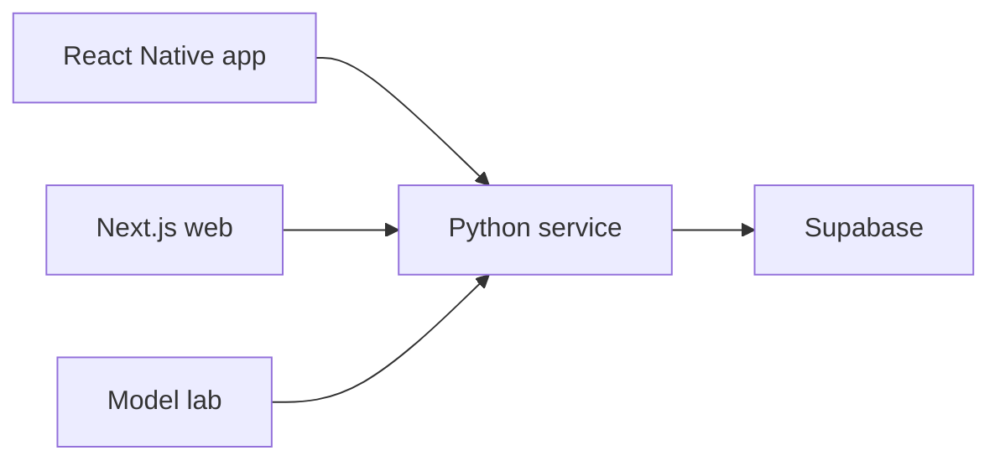
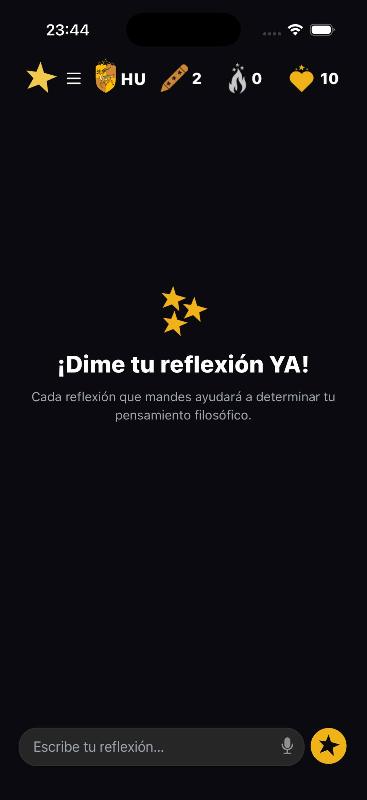
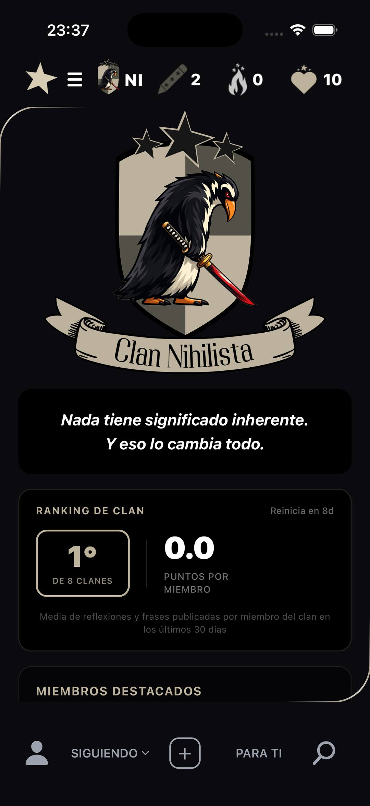
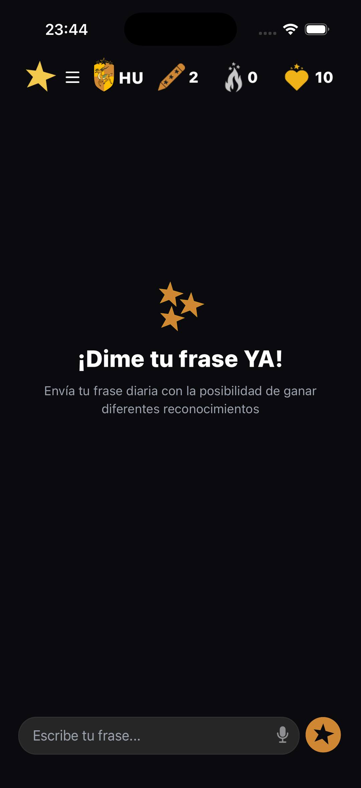
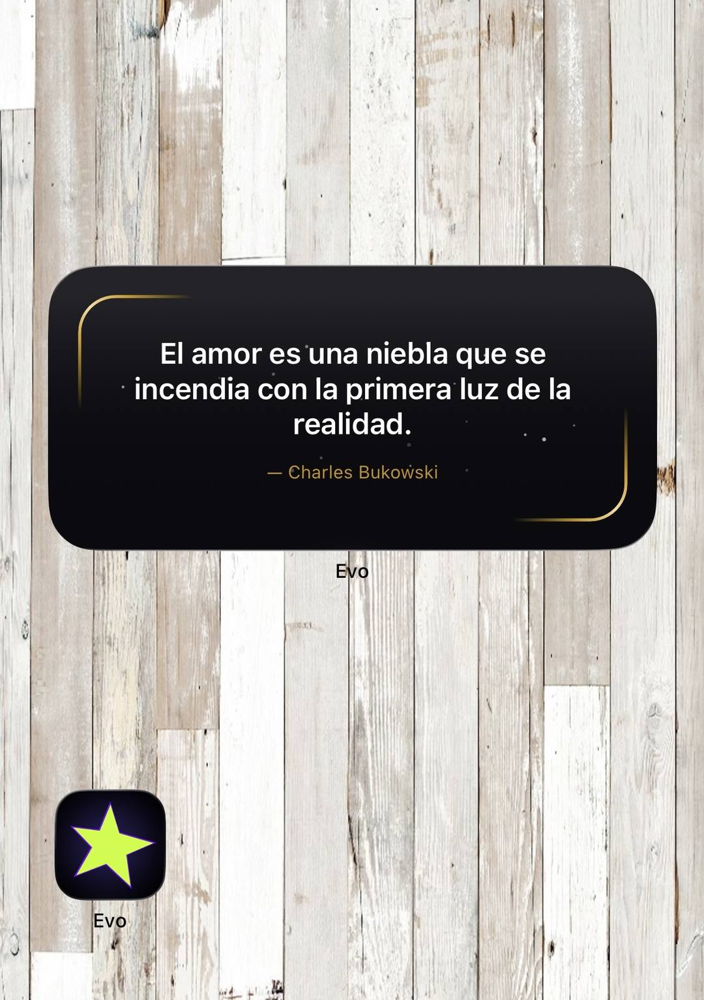
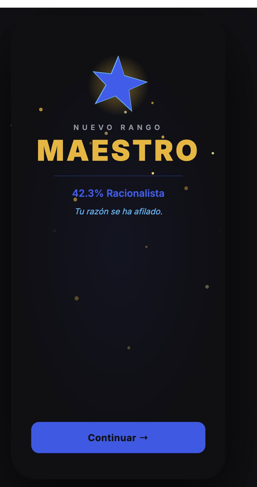

Public showcase of a private codebase in development since February 2026.

# Evo

Evo is a social philosophy app. The AI reads a reflection and answers through the lens of the philosopher that fits it. 150,000 users.

[Website](https://www.evoconn.com/) · [Google Play](https://play.google.com/store/apps/details?id=com.evoconn.evo&hl=es_419)

This repository is a public slice of the private app: the mobile source, the Python service, and the web app. Model weights, knowledge-base files, design assets, keystores, and environment files stay private.

## 📊 The real codebase

The private repository has 578 commits, from 3 February 2026 to 13 June 2026.

Lines of tracked source, excluding dependency and build directories:

| Language | Lines |
|---|---:|
| TSX | 72,906 |
| TypeScript | 33,888 |
| Python | 13,546 |
| JSX | 10,014 |
| SQL | 3,886 |
| JavaScript (mjs) | 2,023 |
| Kotlin | 983 |
| Swift | 672 |
| JavaScript | 666 |

```text
.
├── backend/
│   ├── knowledge_base/
│   └── tests/
├── frontend/
│   ├── app/
│   └── src/
├── mobile/
│   └── src/
├── agents/
├── api/
├── docs/
├── prisma/
├── scripts/
├── shared/
├── supabase/
└── design asset folders (icons, cards, profiles, handoff)
```



## 🎬 Demo

<!-- Add a GIF or video at assets/demo.gif. Do not include user data or keys. -->

## 📱 Screenshots

<table>
<tr>
<td width="250" align="center">

<br>The reflection screen on a phone.
</td>
<td width="250" align="center">

<br>A clan result: Nihilist, first of eight.
</td>
<td width="250" align="center">

<br>The daily phrase screen.
</td>
</tr>
<tr>
<td width="250" align="center">

<br>A phrase on the home-screen widget.
</td>
<td width="250" align="center">

<br>The rank that follows a reflection: Racionalista.
</td>
<td></td>
</tr>
</table>
